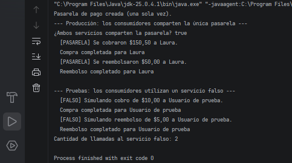

# Ejercicio 8: Refactorización hacia Inyección de Dependencias

## Descripción

Este ejercicio aplica el patrón de diseño **Singleton** en Java, refactorizado para que los componentes no dependan de llamadas estáticas rígidas.

La clase `PaymentGateway` mantiene una única instancia, pero los consumidores (`CheckoutService` y `RefundService`) reciben el servicio mediante sus constructores.

## Objetivos

- Mantener una única instancia de la pasarela de pago durante toda la ejecución.
- Eliminar las llamadas estáticas a `getInstance()` dentro de la lógica de las clases consumidoras.
- Inyectar las dependencias mediante constructores.
- Depender de una interfaz en lugar de una clase concreta.
- Facilitar las pruebas mediante dobles de prueba (*fakes*).

## Implementación del patrón Singleton

La clase `PaymentGateway` utiliza los siguientes elementos:

- **Instancia estática:** mantiene la referencia a la única pasarela de pago.
- **Constructor privado:** impide crear instancias directamente desde otras clases.
- **Método `getInstance()`:** crea la pasarela cuando se solicita por primera vez y devuelve siempre la misma instancia.
- **Interfaz `PaymentService`:** define las operaciones `charge()` y `refund()`, implementadas por `PaymentGateway`.
- **Método `getInstance()` sincronizado:** evita que dos hilos creen instancias diferentes al solicitarla simultáneamente.

La instancia se crea de forma perezosa (*Lazy Initialization*), es decir, únicamente cuando se solicita por primera vez.

## Propósito de las clases del ejercicio

- **`PaymentService`:** define la abstracción de la que dependen los consumidores.
- **`PaymentGateway`:** implementa la pasarela real simulada y controla su instancia única.
- **`CheckoutService` y `RefundService`:** reciben un `PaymentService` por constructor y no necesitan saber si utilizan la pasarela real o una simulación.
- **`FakePaymentService`:** doble de prueba que permite comprobar el comportamiento de los consumidores sin utilizar la pasarela real.
- **`Main`:** actúa como raíz de composición; obtiene la instancia Singleton y la entrega a los consumidores. También demuestra cómo sustituir la implementación por un servicio falso.

En este ejercicio, los cobros y reembolsos son simulados mediante mensajes en la consola. No se realizan transacciones financieras reales.

## Concepto clave

En este ejercicio separamos *quién controla la única instancia* de *quién la utiliza*. El Singleton sigue garantizando que exista una sola instancia de `PaymentGateway`, 
pero los consumidores no la crean ni la buscan de forma global: reciben una dependencia mediante el constructor.

Gracias a la interfaz `PaymentService`, es posible reemplazar la pasarela por `FakePaymentService` durante las pruebas sin modificar `CheckoutService` ni `RefundService`.

## Resultado

## Conclusión

Este ejercicio demuestra que el patrón Singleton y la inversión de dependencias pueden convivir.

La pasarela conserva el control de su instancia única, mientras que los consumidores quedan desacoplados de la implementación concreta y pueden probarse con un servicio simulado.